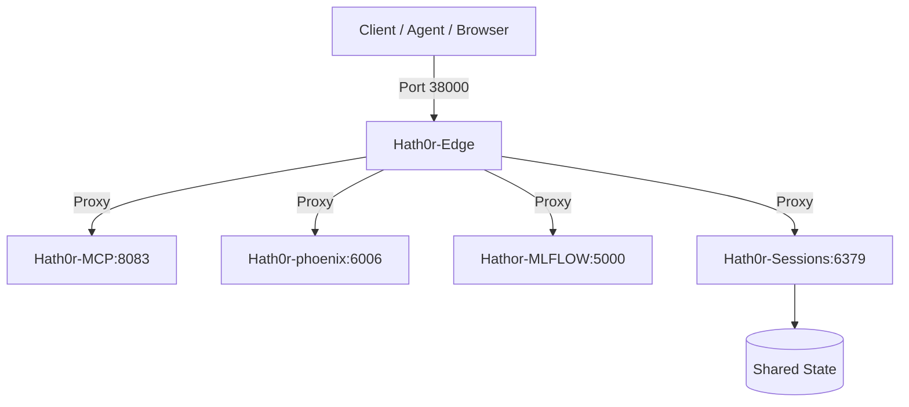

# Deploy Subsystem — Canonical Architecture & References

> Canonical reference models for HATH0R-ATC deployment orchestration.

## Docker Topology

## Service Port Matrix

| Service | Container Name | Container Port | Host Port | Purpose |
|---|---|---|---|---|
| `nginx` | `Hath0r-Edge` | `80` | `38000` | Reverse proxy edge / ingress |
| `redis` | `Hath0r-Sessions` | `6379` | `38079` | State cache & distributed coordination |
| `postgres` | `Hath0r-Data` | `5432` | `35432` | Canonical relational persistence |
| `phoenix` | `Hath0r-phoenix` | `6006` | `36006` | Arize Phoenix observability & tracing |
| `mlflow` | `Hathor-MLFLOW` | `5000` | `35000` | MLflow MLOps experiment tracking |
| `mcp` | `Hath0r-MCP` | `8083` | `38083` | FastMCP knowledge & tool engine |
