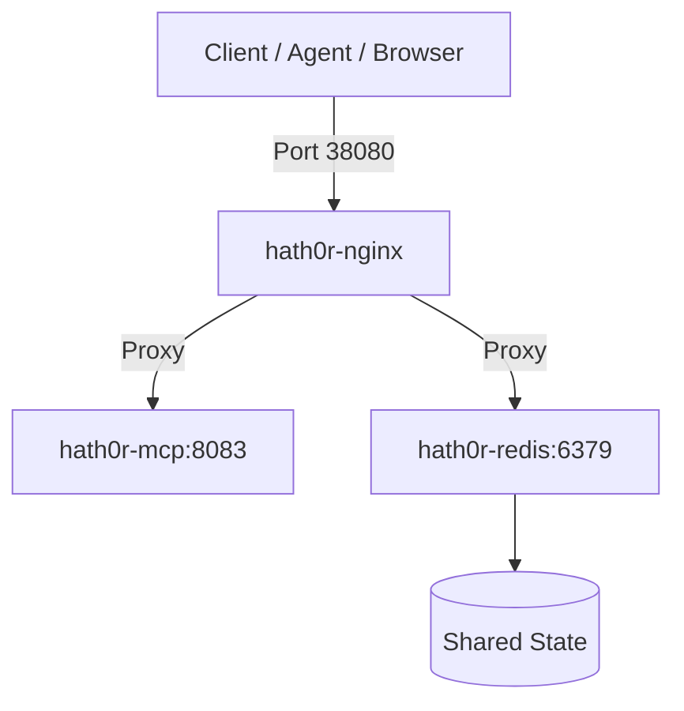

# Deploy Subsystem — Canonical Architecture & References

> Canonical reference models for HATH0R-ATC deployment orchestration.

## Docker Topology

## Service Port Matrix

| Service | Container Port | Host Port | Purpose |
|---|---|---|---|
| `hath0r-nginx` | `80` | `38080` | Reverse proxy edge / ingress |
| `hath0r-redis` | `6379` | `38079` | State cache & distributed coordination |
| `hath0r-mcp` | `8083` | `38083` | Standalone FastMCP knowledge service |
